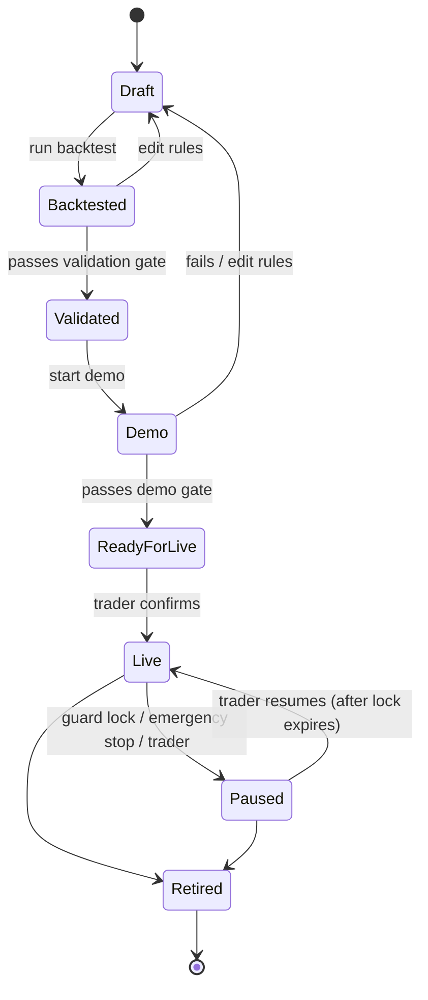

# Market Study — 02. Personas & Use Cases

> **Status:** draft · **Date:** 2026-10-21 · **Based on:** [01-desk-research.md](01-desk-research.md)
>
> The personas below are **hypotheses** built from the desk research and my own experience as a trader. They still need to be checked in the user interviews.

## Positioning (reminder)

Each feature already exists somewhere else. Betty Bot's value is the **connected flow for learners**:

```
test a strategy → prove it on demo → go live with the guard on → journal everything automatically
```

Markets: NASDAQ 100, XAUUSD, EUR/USD · Platform: MetaTrader 5

---

## Personas

### P1 — Léa, the self-taught learner (primary)
- 1–2 years of trading, learns from YouTube, Discords and courses. Trades on a small account.
- **Pain points:** too many strategies, can't tell which ones are real (#6); backtesting by hand is slow so she doesn't do it properly (#4); loses money on strategies she never really tested.
- **Wants:** to stop jumping from one YouTube strategy to the next and learn with a few strategies that have been **properly tested**, with honest numbers on how they perform.
- **Quote (hypothesis):** *"I've tried 10 strategies this year and I still don't know if any of them work."*
- **How Betty Bot helps:** she doesn't bring her own strategy. She uses Betty Bot's built-in strategies and sees, step by step, whether each one passes the backtest and the demo.

### P2 — Karim, the trader who breaks his own rules (primary)
- Has a strategy that looks fine on paper. Loses money through overtrading and revenge trading after losses. May be doing prop firm challenges.
- **Pain points:** breaks his plan "over and over again" (#1); blows his daily loss limit, often around news (#2).
- **Wants:** something that stops him when emotions take over, and shows him the damage.
- **Quote (hypothesis):** *"I know my rules. I just don't follow them after two losses."*
- **How Betty Bot helps:** his problem is discipline, not his strategy. He picks the built-in strategy closest to the way he trades, and the bot **trades it for him** so emotions never get involved, with the risk guard on top. It doesn't watch his manual trades.

### P3 — Amani, the developer-trader (later version)
- Can code, wants to automate a strategy on MT5 without buying a scam bot (#3).
- **Wants:** control over the strategy logic, realistic backtests, and safety nets before going live.
- **Not covered by the MVP:** Amani wants to write their own strategy, and custom strategies are out of scope (see Decisions #2). I keep this persona for a later version.

---

## Actors

| Actor | Type | Role |
|---|---|---|
| Trader | Human | Defines strategies and rules, reviews results, promotes strategies |
| MT5 terminal / broker | External system | Price data, order execution, account balance and equity |
| Economic calendar | External system | High-impact news times (NFP, CPI, FOMC…) |
| Scheduler | Internal system | Time-based jobs (daily reset, news windows, reports) |

---

## Strategy lifecycle

Every strategy moves through fixed stages. **It can't skip a stage**, and that rule is the core of the product.



Editing the rules of a strategy **sends it back to Draft**. Otherwise a tested strategy could be changed without anyone noticing and still count as validated.

---

## Use cases

Priority uses MoSCoW: **M**ust · **S**hould · **C**ould · **W**on't (for now).

### A. Strategy & validation

#### UC-01 — Set up a strategy · M
- **Actor:** Trader
- **Goal:** pick a strategy and set it up without writing code.
- **Main flow:** 1) Trader picks one of **3 built-in strategies**. 2) Chooses market, timeframe and adjusts its settings in a simple form (e.g. indicator periods, SL/TP, position size). 3) Saves it → status *Draft*.
- **Rules:** no code editing. A setup without a stop loss can't be saved. Changing any setting sends it back to *Draft*.

#### UC-02 — Backtest a strategy · M
- **Actor:** Trader
- **Pre:** strategy in *Draft* or *Backtested*.
- **Main flow:** 1) Trader picks the period (default and minimum: last 2 years) and starting capital. 2) System runs the strategy on historical data **with realistic costs** (variable spread, slippage, commission). 3) Shows results: number of trades, win rate, profit factor, max drawdown, longest losing streak, equity curve, trade list. 4) Status → *Backtested*.
- **Alt:** not enough historical data (less than 2 years) → warning, backtest refused.
- **Addresses:** pain points #3, #4, #6.

#### UC-03 — Pass the validation gate · M
- **Actor:** System
- **Goal:** decide objectively whether the backtest is good enough to move to demo.
- **Main flow:** 1) System checks the gate criteria. 2) If all pass → *Validated*. 3) If not → stays *Backtested*, with a clear explanation of which criteria failed and why.
- **Gate criteria (defaults, to adjust once my trading rules are written):**
  - at least 2 years of data
  - minimum 100 trades in total
  - profit factor ≥ 1.3
  - max drawdown ≤ 15%
  - still profitable on **out-of-sample** data (the last ~25% of the period, not used while designing), with **at least 30 trades** in that part
- **Why these numbers:** 30 trades is the usual statistical minimum (central limit theorem), but most sources treat it as a floor and recommend at least 100 trades and 2 years of data covering different market conditions. Even with 100 trades, a 50% win rate could really be anywhere between about 40% and 60%. My first defaults (4 months, 30 trades) were too low: the out-of-sample part would have been about one month and fewer than 10 trades. See [Sources](#sources).
- **Addresses:** #3 (curve fitting), #6 (fake strategies).

#### UC-04 — Run a strategy on demo · M
- **Actor:** Trader, MT5
- **Pre:** strategy *Validated*.
- **Main flow:** 1) Trader starts the strategy on an MT5 demo account. 2) Bot trades it live on demo, with the risk guard active. 3) System compares demo results with the backtest results.
- **Demo gate (defaults):** minimum 4 weeks **and** 20 trades, and both checks below pass. 20 trades is too few to prove the strategy makes money, so the demo mainly checks that **the backtest was realistic**.
  1. **Execution (main check):** for each trade, compare the real spread, slippage and commission with what the backtest assumed. Real costs must stay within **1.5×** the modelled costs on average. This can be measured on every trade, so it means something even with 20 trades.
  2. **Results (wide limits only):** flag the strategy if the demo drawdown goes above the backtest's max drawdown, or if the demo is losing while the backtest was clearly profitable.
- If a check fails → back to *Draft* with the reason (the backtest was probably too optimistic).

#### UC-05 — Promote a strategy to live · M
- **Actor:** Trader
- **Pre:** strategy *ReadyForLive*.
- **Main flow:** 1) System shows a summary: backtest vs demo, risk rules that will apply. 2) Trader confirms explicitly. 3) Status → *Live*.
- **Rules:** it's impossible to go live from any other status. There's no "skip" button.

### B. Risk guard

#### UC-06 — Configure risk rules · M
- **Actor:** Trader
- **Defaults:** see [03-strategies-and-risk-rules.md](03-strategies-and-risk-rules.md).
- **Rules available:** max risk per trade (% of balance), daily loss limit, max trades per day, stop after X losses in a row, max open positions, news pause window (e.g. 15 min before → 15 min after).
- **Rules:** loosening a rule only takes effect **the next trading day**. Tightening applies immediately. This prevents changing the rules in the middle of a tilt.

#### UC-07 — Enforce risk rules · M
- **Actor:** System, MT5
- **Scope:** only the bot's own trades. Trades placed by hand in MT5 are ignored.
- **Main flow:** 1) Before every order, the guard checks all rules, counting **open losses as well** (pain point #2). 2) If a rule would be broken → the order is blocked and the reason logged. 3) If the daily loss limit is reached → close positions, lock trading until the next day, notify the trader.
- **Addresses:** #1, #2.

#### UC-08 — Pause around news · S
- **Actor:** Scheduler, Economic calendar
- **Main flow:** 1) System loads the high-impact events for EUR/USD, gold and NASDAQ (USD and EUR news). 2) During the pause window, no new trades open. 3) Optional: close or protect open positions before the event.
- **Alt:** calendar unavailable → fail safe: pause trading and alert the trader.

#### UC-09 — Emergency stop · M
- **Actor:** Trader (or System on a critical error)
- **Main flow:** 1) One button in the dashboard. 2) Closes all positions, cancels pending orders, sets all live strategies to *Paused*. 3) Logs who triggered it and why.
- **Also triggered automatically on:** connection to MT5 lost for longer than X minutes, or unexpected errors repeating.

### C. Journal & review

#### UC-10 — Journal trades automatically · M
- **Actor:** System, MT5
- **Main flow:** every trade (backtest, demo, live) is saved with its strategy, entry/exit, SL/TP, result, the rules checked and any rules blocked. No manual entry.
- **Optional:** trader adds a note or an emotion tag afterwards.
- **Addresses:** #5.

#### UC-11 — Performance dashboard · M
- **Actor:** Trader
- **Shows:** each strategy's status in the lifecycle, key metrics, and **backtest vs demo vs live** side by side, plus today's risk usage (e.g. "62% of daily loss limit used").

### Out of scope for now · W
- Guarding manual trades, and the "what your rule breaks cost you" report that depended on it (the bot only manages its own trades)
- Custom strategies written in code
- Buying, selling or sharing strategies (marketplace)
- AI-generated strategies
- Markets other than NAS100 / XAUUSD / EURUSD
- Platforms other than MT5
- Mobile app

---

## MVP scope

The smallest version that still shows the whole flow end to end:

1. UC-01 Set up a strategy (start with 1 of the 3 built-in strategies, add the other 2 after)
2. UC-02 Backtest with realistic costs
3. UC-03 Validation gate
4. UC-04 Demo run
5. UC-05 Promote to live
6. UC-06 / UC-07 Risk guard
7. UC-09 Emergency stop
8. UC-10 Auto-journal
9. UC-11 Dashboard

Next: UC-08 news pause.

---

## Decisions

| # | Question | Decision |
|---|---|---|
| 1 | Guard manual trades too? | **No.** Only the bot's own trades. |
| 2 | How are strategies defined? | **3 built-in strategies**, set up through a simple form. No code. They are Betty Bot's strategies, not the users' own: users pick one and adjust its settings. |
| 3 | Backtest engine | **Not decided yet.** It's the heaviest part of the code, so I'll prototype both options (my own engine in Java, or MT5's Strategy Tester) and pick the one that's easier to build and to run, including in the cloud. Note: MT5 runs on Windows, so the Strategy Tester would need a Windows server. |
| 4 | Historical data source | **MT5** (exported from the broker's terminal). |
| 5 | Broker | **Exness or FBS**, whichever accepts the account. Prefer a **raw spread** account (tight spread + commission) so backtest costs match live costs. To check: the broker accepts clients from East Africa or France. |

| 6 | Which 3 strategies? | **Trend Pullback, Opening Range Breakout, Mean Reversion.** See [03-strategies-and-risk-rules.md](03-strategies-and-risk-rules.md). |
| 7 | Risk rules | **1% risk per trade (max 2%)**, 3% daily loss limit, stop after 3 losses in a row. Full list in 03. |

## Open questions

1. **Gate thresholds:** the defaults in UC-03 / UC-04 are based on common practice (see Sources), but they stay starting values until the first backtests show whether they're too strict or too loose. To check: does each strategy actually produce 100 trades in 2 years? If not, the period has to be longer.
2. **Backtest engine:** own Java engine or MT5 Strategy Tester (Decisions #3).

---

## Sources

Apart from the AMS paper, these are blogs from trading tool companies. I use them as common practice, not as formal standards.

- [Medium – How many trades are enough? Statistical significance in backtesting](https://medium.com/@trading.dude/how-many-trades-are-enough-a-guide-to-statistical-significance-in-backtesting-093c2eac6f05): 30 trades as the lowest starting point (central limit theorem)
- [TradeZella – Backtesting trading strategies: the complete guide](https://www.tradezella.com/blog/backtesting-trading-strategies): 100 trades minimum, 200–500 for confidence; market conditions matter as much as the count
- [TradeAlgo – How to backtest a trading strategy](https://www.tradealgo.com/trading-guides/day-trading/backtest-trading-strategy): 100 trades minimum, 200+ for high confidence
- [TradersCasa – How many trades should you backtest?](https://traderscasa.com/blog/how-many-trades-to-backtest)
- [PineConnector – How many trades for a backtest?](https://www.pineconnector.com/blogs/pico-blog/how-many-trades-backtest-sample-size): with 100 trades at a 50% win rate, the margin is about ±10 points
- [Backtrex – Out-of-sample testing](https://backtrex.com/en/blog/out-of-sample-testing-trading-strategy-validation): minimum 30 out-of-sample trades; at least 2 years of data
- Bailey, Borwein, López de Prado & Zhu (2014), [*Pseudo-Mathematics and Financial Charlatanism: The Effects of Backtest Overfitting on Out-of-Sample Performance*](https://www.ams.org/notices/201405/rnoti-p458.pdf), Notices of the AMS 61(5): the more variants of a strategy you try on the same data, the longer the backtest needs to be
